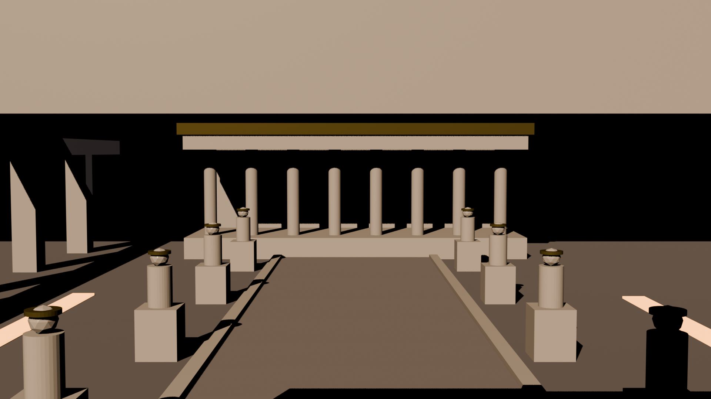
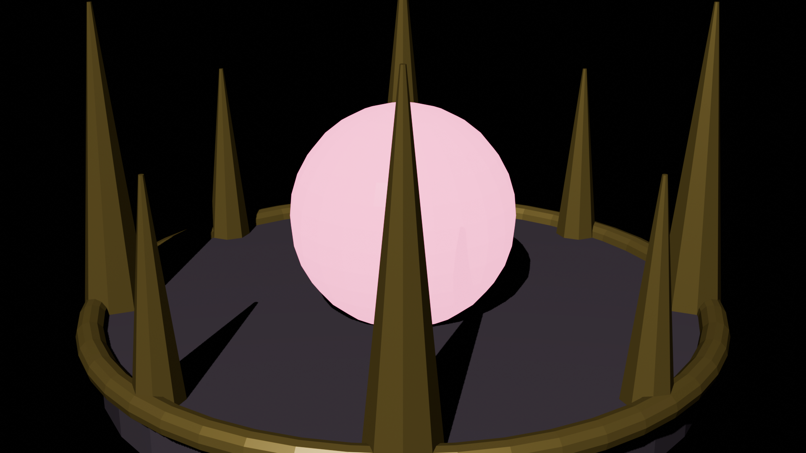
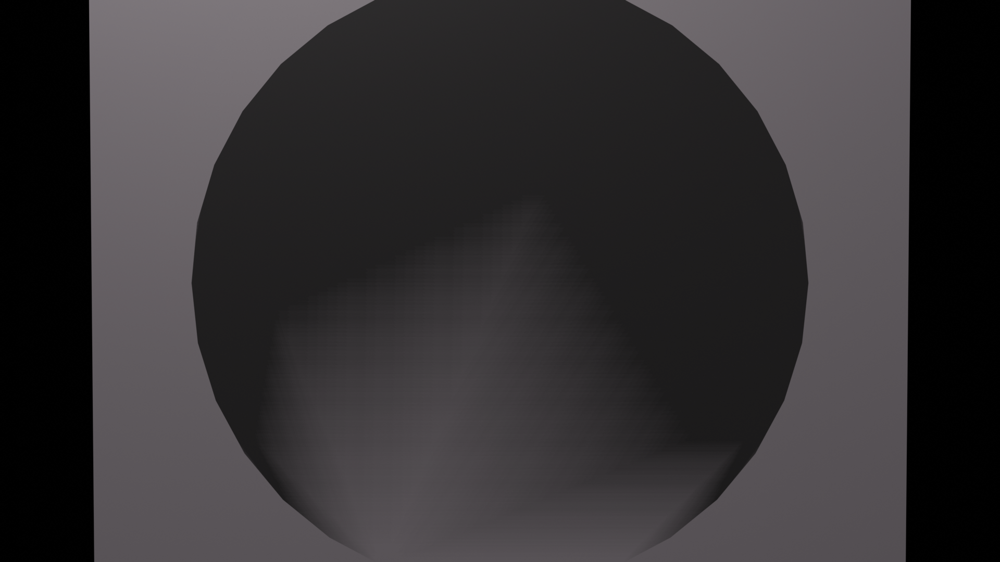

# Relic Rush

<p align="center">
  <strong>A dark-fantasy Roblox game project built with Luau.</strong><br/>
  Mythical relics, ancient ruins, dangerous vaults, and a world designed around discovery and risk.
</p>

<p align="center">
  <a href="https://github.com/MRZ786/RelicRushAI"></a>
  
  
</p>

Relic Rush is an independent Roblox game-development project. Its creative direction blends dark fantasy environments with a relic-hunting adventure: explore mysterious locations, uncover powerful artifacts, and build a world where discovery and danger go hand in hand.

**This repository is a work-in-progress development snapshot.** The design direction and assets are being developed alongside the game systems. Not every planned feature is implemented or playable yet; this repository is not a production release.

## Visual direction

<p align="center">
  
  
</p>
<p align="center">
  
  
</p>

These images are visual development assets and concept renders, not screenshots of a finished live game.

## Project structure

| Path | Purpose |
| --- | --- |
| `src/client/` | Client controllers and UI |
| `src/server/` | Server services, world builders, and test runner |
| `src/shared/` | Shared definitions, networking utilities, types, and audio configuration |
| `assets/models/` | Exported OBJ/MTL models |
| `assets/evidence/` | Environment concepts and rendered asset previews |
| `tools/` | Asset generation, world generation, and development utilities |
| `default.project.json` | Rojo DataModel mapping |

## Getting started

### Requirements

- Roblox Studio
- [Rojo](https://rojo.space/) and its Roblox Studio plugin
- Git

Some asset-generation utilities may additionally require Blender and Python packages. Check each tool's source and prerequisites before running it.

### Connect the project with Rojo

1. Clone this repository.
2. Open a terminal in the repository root.
3. Run:

   ```bash
   rojo serve default.project.json
   ```

4. Open Roblox Studio and connect using the Rojo plugin.

The game world is assembled by `src/server/world/WorldBuilder.luau` during server startup. The Rojo mapping includes the client, server, shared modules, lighting, and market spawn location.

## Development status

Relic Rush is actively structured as a development project, but feature completeness and runtime stability have not been independently verified. Treat the source and tools as experimental. Review scripts before executing them and test changes in a separate Roblox Studio place before using them in a live experience.

## Contributing

There is no formal contribution process yet. If you want to discuss an idea or report a reproducible issue, open a GitHub Issue with clear steps, expected behavior, and relevant logs or screenshots. Please do not post credentials, private player data, or personal information.

## Security

Never commit API keys, access tokens, credentials, private keys, personal machine paths, local backups, or generated environment files. Keep local configuration in ignored files and use environment variables or a secrets manager for credentials. Report suspected vulnerabilities privately to the repository owner rather than publishing exploit details.

## License and asset rights

No open-source license has been declared. Unless a license is added, all rights remain with the project owner. Public visibility does not grant permission to reuse, modify, redistribute, or commercially exploit the code or assets.
